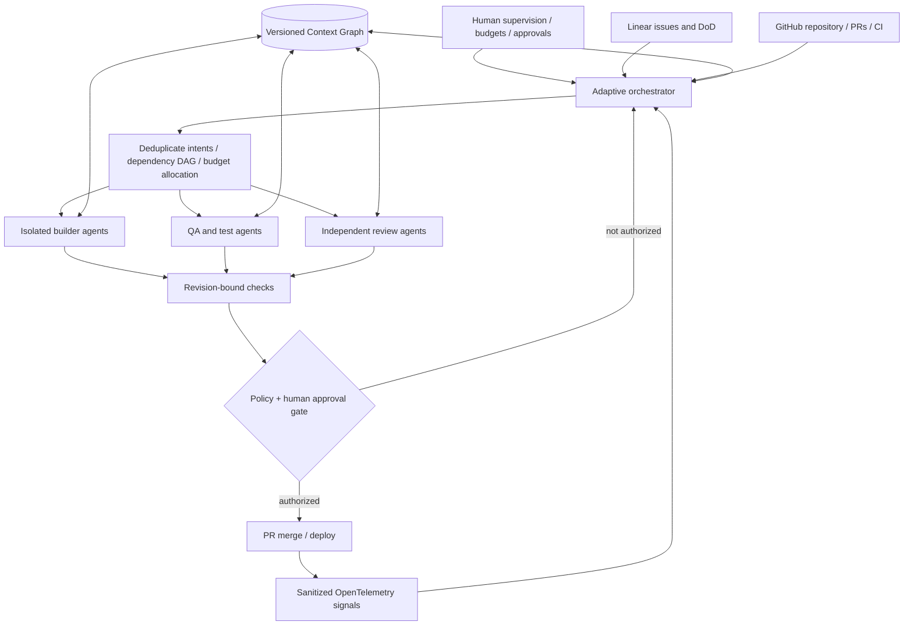
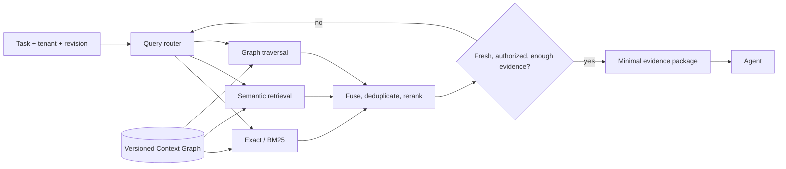

# Autonomous SDLC: proposed production architecture

The project is a deterministic **research simulation**. The following flow is a *target architecture*, not a claim that all connectors or cloud coding agents have been integrated.

## Adaptive retrieval layer

## Optimization objective

Minimize total model, retrieval, retry, tool and coordination cost **subject to** non-inferior completion quality, evidence recall, test pass, review independence, freshness, access control and human approvals.

Production measurement must separate hosted-model token use from cloud-agent container RAM/CPU and model-serving hardware memory (typically not exposed).

## Why the 3-SAT connection is only an analogy

Recent AI-assisted theoretical work on 3-SAT motivated the question of whether changing a computational representation or search order can reduce computation. It does **not** provide a proven complexity improvement for these agent or RAG workflows. Any claimed savings need controlled benchmarks with real agents, fixed task sets and independent quality gates.
