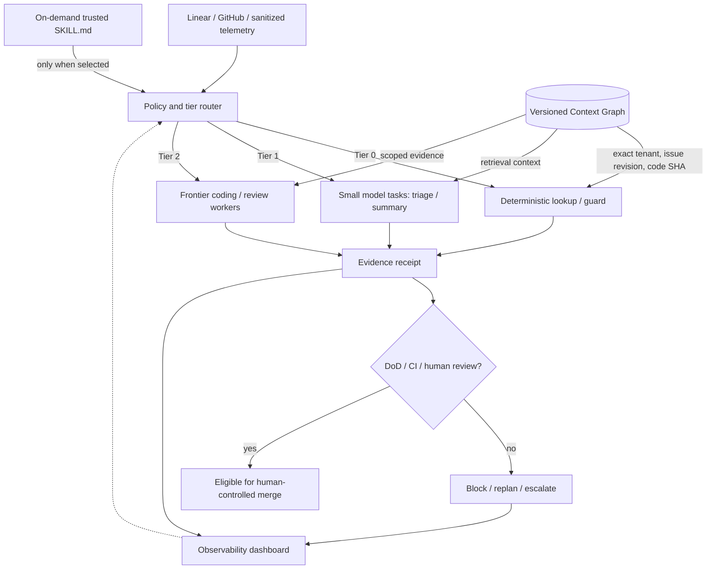

# Autonomous SDLC v3: Tiered execution + progressive skills + VCG

## Why this change

Inspired by a public multi-tier personal agent architecture, this iteration adds a deterministic tier router, reusable-on-demand skills, and revision-aware evidence reuse to the existing autonomous SDLC and budget-adaptive RAG PoC. This is an original SDLC implementation; no external app or author's source code is copied. Public nomenclature: **Versioned Context Graph (VCG)** throughout.

## Architecture

## Implemented now

- `TierRouter` selects deterministic, small-model or frontier-agent tiers from task type, risk and skill minimum. **No budget downgrade** of high-risk work.
- `SkillCatalog` loads name/description metadata at initialization but reads full skill instructions only when invoked. Four public, generic skills are supplied.
- `VersionedEvidenceStore` enforces tenant, issue revision and optional source version; opaque receipts bind to exact issue ID and commit hash. Rejects old version overwrites. Ephemeral in-memory prototype only.
- A real local **BM25 / sparse TF-IDF / graph expansion** retrieval pass from the existing sample corpus feeds synthetic `Evidence` to the v3 demo. It is not vector ANN or a model-generated answer.
- Dashboard `v3 · Tiered AI OS` shows routing, context IDs, simulated budgets, human approval blocks, and lazy skill usage. `/api/os/demo` is read-only and localhost-bound.
- 27 local tests, including 13 new tiered OS tests. No model calls or actual PRs.

## What remains future work

1. Replace simulation worker tiers with real provider-specific models in separate cloud sandboxes. Capture billed input/output/cache tokens and dollars with OpenTelemetry.
2. Bind skills to allowed tools/policies, prohibit unsandboxed arbitrary execution, and cryptographically attest execution receipts and exact source commits.
3. Introduce durable per-tenant memory with ACLs, provenance/TTL, source revision and deletion/retention rules. Add explicit raw/curated/outputs tiers if needed. An Obsidian vault can be an optional *export*, never the authority for multi-agent shared state.
4. Support a broker-driven task queue, leased workers, request tracing, cancellation, retries, and VCG invalidation on GitHub and Linear webhooks.
5. Optional voice control via faster-whisper and Kokoro, separately permissioned; local audio handling is not equivalent to local LLM processing.
6. Proper A/B trials: match tasks, models, quality gates, base commits and latency budgets. Demonstrate non-inferior quality before claiming cost improvements.

## Measurement warning

The 44.5% reported by the demonstration is a **modeled synthetic difference**, generated by fixed per-tier token assumptions on seven fabricated requests. It is not observed savings from Claude, Codex, Jev, or any provider. Two tasks are configured to require human approval; there is no automatic merge or deployment. Memory is not persisted across process restarts, and the local HTTP dashboard must not be exposed on a public interface.

## Research/background

- [Anthropic Skills architecture](https://platform.claude.com/docs/en/agents-and-tools/agent-skills/overview)
- [Anthropic Claude Code skills/hooks/subagents](https://claude.com/blog/steering-claude-code-skills-hooks-rules-subagents-and-more)
- [Anthropic Long-running agent harnesses](https://www.anthropic.com/research/effective-harnesses-for-long-running-agents)

The 3-SAT research discussed in the project's original README remains an *analogy about representation*, not a directly applicable efficiency theorem.